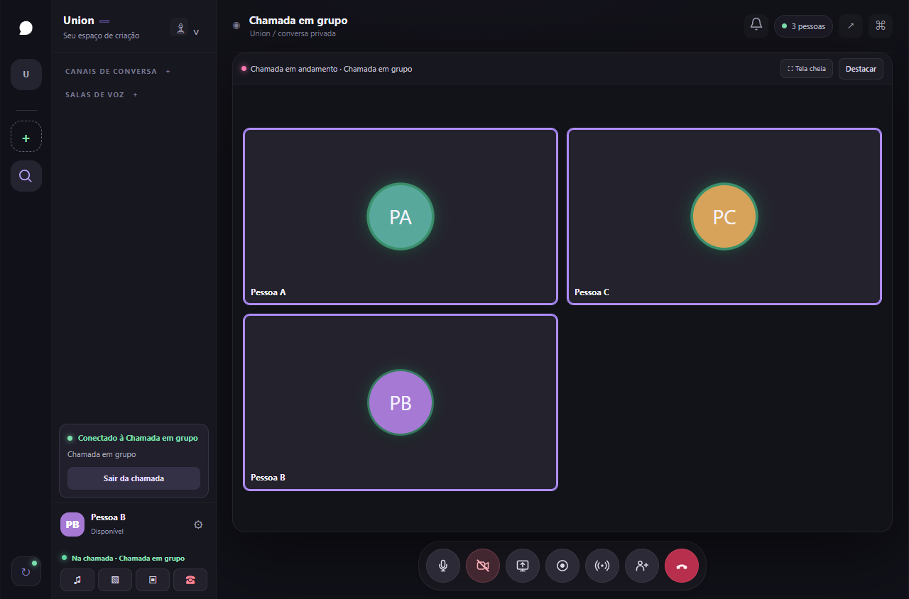
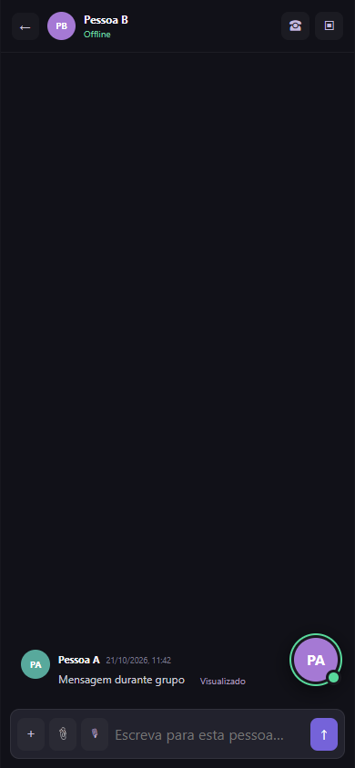

<strong>Seu grupo tem um lugar aqui.</strong> Comunidades, conversas e chamadas. Na web e em beta para Windows.

<a href="https://union.useseletto.com/">Conheça o Union</a> · <a href="https://union.useseletto.com/app/?view=messages">Abrir no navegador</a> · <a href="https://union.useseletto.com/downloads.html">Baixar para Windows</a>

## O que é o Union?

O Union é um aplicativo de comunicação para comunidades, mensagens de texto e chamadas de voz e vídeo. É desenvolvido pela UseSeletto Technology, com acesso pelo navegador e versão beta para Windows.

Site oficial: **[union.useseletto.com](https://union.useseletto.com/)**. [Leia a apresentação e as perguntas frequentes](https://union.useseletto.com/sobre.html).

## Um espaço para estar junto

A call depois do jogo. A ideia que virou projeto. O papo que foi longe. O Union reúne sua galera em um lugar para conversar, compartilhar a tela e organizar comunidades.

| No Union | O que você encontra |
| :--- | :--- |
| Comunidades | Categorias, canais de texto, voz e avisos da equipe. |
| Conversas | Mensagens diretas, convites e chamadas privadas com até seis pessoas. |
| Voz e vídeo | Câmera, compartilhamento de tela e ajustes de microfone, conforme suporte do aparelho. |
| Continue por perto | Minimize a chamada no celular e navegue pelas conversas. |
| Acompanhe o papo | Central de notificações, leitura e menções sincronizadas. Web Push opcional por dispositivo. |
| Proteja sua conta | Verificação em duas etapas TOTP opcional e códigos de recuperação. |

## Veja o beta

Capturas de demonstração com contas de teste.

## Comece a conversar

- **Web:** [abrir o Union](https://union.useseletto.com/app/?view=messages), sem instalar.
- **Windows 64 bits:** [instalador, versão e checksum](https://union.useseletto.com/downloads.html).
- **Celular, macOS e Linux:** use a versão web. Não há instaladores nativos dessas plataformas disponíveis aqui.

### Estado do beta

Versão do instalador: **0.3.0-beta.1**. O executável ainda não tem assinatura de editor nem atualização automática. O conteúdo web é atualizado separadamente.

Áudio, vídeo, notificações e conectividade ainda precisam de validação em aparelhos e redes reais. A disponibilidade em redes restritas e a recuperação por e-mail dependem da infraestrutura configurada. Pagamentos e assinaturas ainda não estão disponíveis.

## Ajuda, novidades e confiança

[Ajuda](https://union.useseletto.com/ajuda.html) · [Versões](https://github.com/Danelicia/union-app/releases) · [Privacidade](https://union.useseletto.com/privacidade.html) · [Segurança](https://union.useseletto.com/seguranca.html) · [Termos](https://union.useseletto.com/termos.html)

Sugestões e problemas de uso podem ser enviados nas [issues](https://github.com/Danelicia/union-app/issues). Para privacidade, exclusão de dados ou vulnerabilidades, escreva para **contato.useseletto@gmail.com**. Não publique dados pessoais, senhas ou detalhes de vulnerabilidades nas issues.

### Sobre este repositório

Este repositório contém materiais de apresentação e distribuição do Union. **O código de implementação do produto é mantido em repositório privado.** Os arquivos de código-fonte gerados automaticamente pelo GitHub nesta vitrine contêm somente os materiais públicos listados aqui.

<strong>Union</strong> by <a href="https://useseletto.com">UseSeletto</a> Feito para estar junto.

